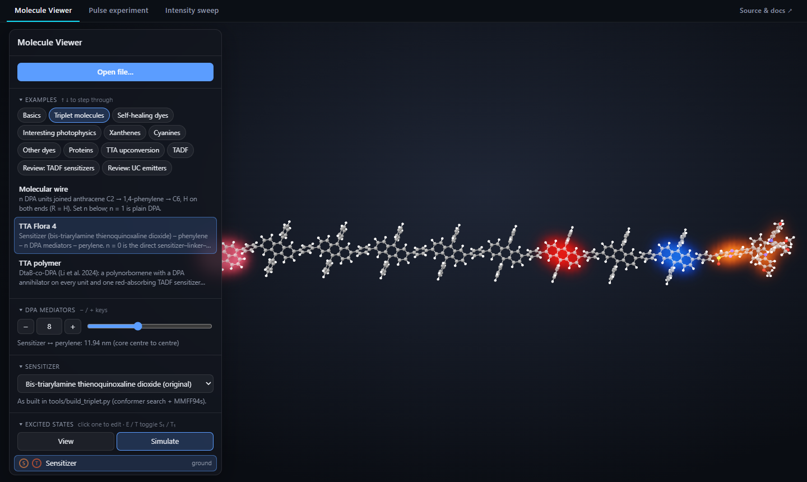
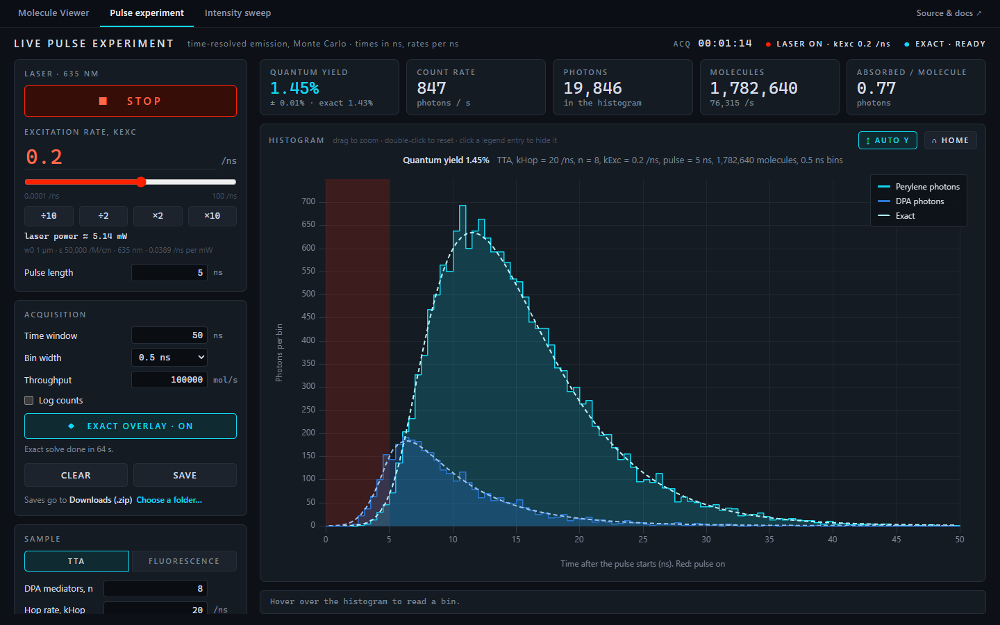
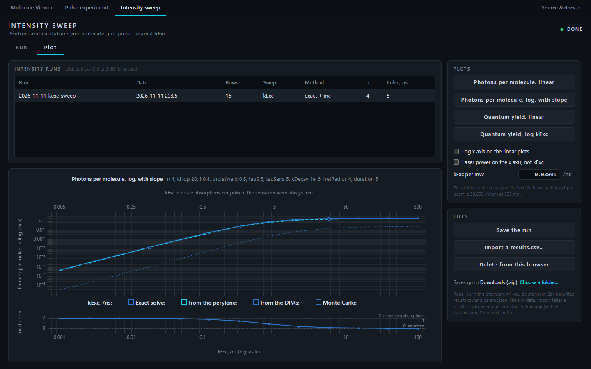

# Molecule Viewer and TTA pulse experiments

A 3D molecule viewer that shows where excited states live and how they move, plus two simulated pulsed-laser
experiments on **triplet–triplet annihilation (TTA) upconversion** molecules: light comes in red and goes out blue.

**Open it: [yclen.github.io/molecule-viewer](https://yclen.github.io/molecule-viewer/)**. Everything runs in your
browser, with nothing to install.



## What's in here

The site has three tabs along the top:

| Tab | What it does |
|---|---|
| **[Molecule Viewer](https://yclen.github.io/molecule-viewer/#viewer)** | Opens `.xyz` molecules in 3D, lights up their singlet and triplet states, and runs small scripted simulations on them. Over 100 built-in examples: dyes, proteins, TADF sensitizers, upconversion molecules. |
| **[Pulse experiment](https://yclen.github.io/molecule-viewer/#pulse)** | Flashes simulated molecules with a laser pulse, over and over, and builds the photon arrival-time histogram live, like a time-resolved measurement. |
| **[Intensity sweep](https://yclen.github.io/molecule-viewer/#sweep)** | Runs photons per molecule and quantum yield against laser power, then plots them, including the slope-2-to-1 bend that marks TTA. |

Each link opens straight onto its tab. The simulations run on your own computer's processor cores, so there's no
server, no account, and nothing leaves your machine unless you save it.

To use it offline, download
[`molecule-viewer.html`](https://github.com/yclen/molecule-viewer/releases/latest/download/molecule-viewer.html) and
double-click it. The whole site is that one file.

## The tabs

### Molecule Viewer

- **Drag to rotate, scroll to zoom.** Open your own `.xyz` file with **Open file…**, or drop one on the page.
  Bonds are worked out from the distances between atoms.
- **Excited states.** Each chromophore can glow in its singlet (S₁) or triplet (T₁) state. The glow sits where the
  excitation really is, from a Hückel calculation on the 3D structure.
- **Simulate mode.** A short JavaScript script switches states on and off over time: excitation, intersystem
  crossing, triplet hopping, annihilation and emission, with sliders for every rate.
- **Examples in tabs:** Triplet molecules (sized live, such as a TTA chain with *n* DPA units), Self-healing dyes,
  Interesting photophysics (FRET, light harvesting, LOV2, GCaMP…), plus libraries of dyes, proteins and molecules
  from recent papers. Each geometry is built and checked by the scripts in [`tools/`](tools/).
- **Measure** distances, angles and dihedrals by clicking atoms.

The full guide is in [docs/viewer.md](docs/viewer.md): every control and script function, and where each example
comes from.

### Pulse experiment



Press **Start** and the page flashes fresh molecules all the time, about 100,000 a second. Every emitted photon lands
in the histogram by its arrival time after the pulse. It starts as scattered counts and smooths out as it fills, like
a real time-correlated photon-counting measurement. The laser slider sets the excitation rate, `kExc` (equivalent to
laser power, shown in mW). **Exact overlay** works out the noise-free histogram the counts are heading for and draws
it dashed (seconds for small molecules, about a minute at *n* = 8). Switch the sample between the TTA molecule and a
plain fluorescent dye to compare. **Save** writes the histogram, a summary and a picture.

### Intensity sweep



The **Run** tab sweeps `kExc` across a range (log-spaced by default) and works out the photons and excitations per
molecule in one pulse at each step: exactly, by Monte Carlo, or both. A stopped sweep keeps every point it finished.
The **Plot** tab lists your sweeps and draws them, one at a time or several together, in four figures. At low power
the slope is 2, because an upconverted photon needs two absorbed photons, one for each triplet. It bends down through
1 toward 0 as the molecule saturates.

### Saving your data

Runs are saved as the same files the Python version writes (`results.csv`, `params.json`, …), so they open in
Excel, Python or anything else.

- **Chrome or Edge: work in a folder on your computer.** Click **Choose a folder…** under Save. From then on, each
  sweep writes itself into that folder as it runs (one subfolder per run, like `sim/data`), Pulse saves go there
  too, and the Sweep tab's Plot list shows every sweep already in the folder. Choose this project's `sim/data` folder
  and the website and the Python app see each other's runs. Choose a folder that Google Drive, Dropbox or OneDrive
  syncs, and your runs land there. The browser remembers the folder, and asks once per visit to use it again.
- **Any browser:** without a folder, sweeps are kept in the browser (so the Plot list survives a reload, on that
  browser only), and **Save** downloads a run as one `.zip`. **Import** loads a `results.csv`, including ones from the
  Python app.

## The model

The TTA molecule is a chain: a sensitizer, *n* DPA mediators, then a perylene. Each site is in its ground state, a
triplet or a singlet. The sensitizer absorbs and crosses to its triplet, triplets hop along the DPAs, two that meet
can annihilate into one singlet, and singlets emit. The simulation is exact (the Gillespie method, no time step),
with a matching master-equation solver for noise-free answers. The rules and parameters are in
[`sim/README.md`](sim/README.md), and the math is in [`sim/formulas.md`](sim/formulas.md).

The website's engine ([`src/sim/`](src/sim/)) is a JavaScript port of the Python one in [`sim/`](sim/), which stays the
reference. [`tools/check_js_engine.py`](tools/check_js_engine.py) runs both on the same inputs and checks that they
agree: the rules exactly, the exact solvers to about one part in a million or better, and the Monte Carlo within its
error bars.

## The Python version (optional)

[`sim/`](sim/) also has the original desktop apps (`live.py` and `sweep_gui.py`, the same two experiments as
PyQt windows) and a command line for batch runs (`tta_sim.py`). The website does the same things; the Python version
is for scripting, very long runs, and checking the website against it. To run it:

1. Install [Python](https://www.python.org/downloads/) 3.10 or newer (on Windows, tick **Add python.exe to PATH**).
2. Get this repository: **Code → Download ZIP** on GitHub, or `git clone`.
3. Double-click `Launch.bat` (Windows) or `Launch.command` (macOS), or run:

   ```bash
   python launch.py
   ```

The first run sets up a private Python environment in `.venv/` (a few minutes, once). With
[uv](https://docs.astral.sh/uv/) you can skip that: `uv run sim/live.py` or `uv run sim/sweep_gui.py`. The command line
is documented in [`sim/README.md`](sim/README.md).

## Project layout

```
index.html, src/     the website: the viewer (Three.js) and the lab tabs (src/lab/)
src/sim/             the simulation engine the website runs, a port of sim/
samples/             the viewer's built-in examples and simulation scripts
tools/               scripts that build and check the example geometries, and check src/sim/ against sim/
sim/                 the Python simulation: engine, desktop apps and command line
docs/                the viewer guide and the geometry validation reports
launch.py            the launcher for the Python apps; Launch.bat and Launch.command open it with a double-click
```

## Development

```bash
npm install
```

```bash
npm run dev
```

The second command serves the site at http://localhost:5173 and reloads on save. `npm run build` bundles everything,
the simulation workers included, into one self-contained `dist/index.html`. Every push to `main` rebuilds the website,
and pushing a tag such as `v0.2.0` also attaches that file to a GitHub Release. On Windows, `npm run shortcut` makes
a desktop shortcut that opens your local build in its own window.

After changing either engine, run the comparison (it needs Node and the Python packages):

```bash
python tools/check_js_engine.py
```

Rebuilding the example geometries needs RDKit (`pip install rdkit`): see [docs/viewer.md](docs/viewer.md#examples).

## License

[MIT](LICENSE). If you use this in research, see [CITATION.cff](CITATION.cff).
