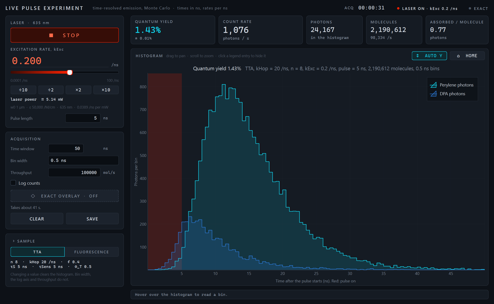
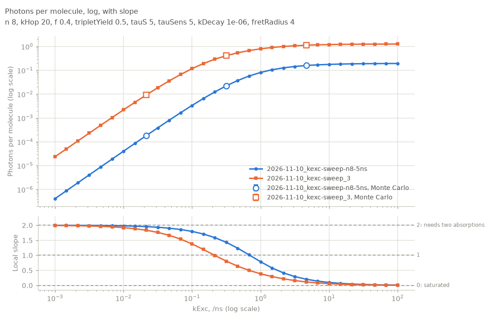

# Molecule Viewer and TTA pulse experiments

A 3D molecule viewer that shows where excited states live and how they move, plus two desktop apps that simulate
pulsed-laser experiments on **triplet–triplet annihilation (TTA) upconversion** molecules: light comes in red and
goes out blue.


## What's in here

| Part | What it does | Runs in | Needs |
|---|---|---|---|
| **[Molecule Viewer](#molecule-viewer)** | Opens `.xyz` molecules in 3D, lights up their singlet and triplet states, and runs small scripted simulations on them. Over 100 built-in examples: dyes, proteins, TADF sensitizers, upconversion molecules. | Your browser | Nothing |
| **[Live pulse experiment](#live-pulse-experiment)** | Flashes simulated molecules with a laser pulse, over and over, and builds the photon arrival-time histogram live, like a time-resolved measurement. | A desktop window | Python 3.10+ |
| **[Intensity sweep](#intensity-sweep)** | Runs photons per molecule and quantum yield against laser power, then plots them, including the slope-2-to-1 bend that marks TTA. | A desktop window | Python 3.10+ |

The two desktop apps share one simulation engine in [`sim/`](sim/). The viewer's **TTA cascade** script follows the
same rules on a single molecule, so you can watch what the engine is counting.

## Launch it

### Molecule Viewer

**Open it here: [yclen.github.io/molecule-viewer](https://yclen.github.io/molecule-viewer/)**. Nothing to install.

To use it offline, download
[`molecule-viewer.html`](https://github.com/yclen/molecule-viewer/releases/latest/download/molecule-viewer.html) and
double-click it. The whole app, examples included, is that one file.

### The two pulse experiment apps

1. Install [Python](https://www.python.org/downloads/) 3.10 or newer, if you don't have it. On Windows, tick
   **Add python.exe to PATH** in the installer.
2. Get this repository: **Code → Download ZIP** on GitHub (then unzip it), or `git clone`.
3. Start the launcher:
   - **Windows**: double-click `Launch.bat`.
   - **macOS**: double-click `Launch.command`. If macOS blocks it, right-click it and choose **Open**.
   - **Any system**, from a terminal in the project folder:

     ```bash
     python launch.py
     ```

4. Pick an app from the menu.

The first time takes a few minutes: the launcher makes a private Python environment in `.venv/` inside the project
folder and installs the packages into it. Nothing is installed anywhere else on your computer. After that, apps
start in seconds. You can skip the menu with `python launch.py live`, `python launch.py sweep` or
`python launch.py viewer`. To start over, delete the `.venv` folder.

<details>
<summary>Other ways to run them</summary>

With [uv](https://docs.astral.sh/uv/), each script declares its own packages, so this is all you need:

```bash
uv run sim/live.py
```

```bash
uv run sim/sweep_gui.py
```

In your own environment:

```bash
pip install -r requirements.txt
```

```bash
python sim/live.py
```

The command-line simulation (`python sim/tta_sim.py …`) is documented in [`sim/README.md`](sim/README.md).

</details>

## The parts

### Molecule Viewer

- **Drag to rotate, scroll to zoom.** Open your own `.xyz` file with **Open file…**, or drop one on the page.
  Bonds are worked out from the distances between atoms.
- **Excited states.** Each chromophore can glow in its singlet (S₁) or triplet (T₁) state. The glow sits where the
  excitation really is, from a Hückel calculation on the 3D structure.
- **Simulate mode.** A short JavaScript script switches states on and off over time: excitation, intersystem
  crossing, triplet hopping, annihilation and emission, with sliders for every rate.
- **Examples in tabs:** Triplet molecules (sized live, such as a TTA chain with *n* DPA units), Self-healing dyes,
  Interesting photophysics (FRET, light harvesting, LOV2, GCaMP…), plus libraries of dyes, proteins and molecules
  from recent papers. Each geometry is built and checked by the scripts in [`tools/`](tools/).
- **Measure** distances, angles and dihedrals by clicking atoms.

The full guide is in [docs/viewer.md](docs/viewer.md): every control and script function, and where each example
comes from.

### Live pulse experiment



Press **Start** and the app flashes fresh molecules all the time, about 100,000 a second. Every emitted photon lands in
the histogram by its arrival time after the pulse. It starts as scattered counts and smooths out as it fills, like a
real time-correlated photon-counting measurement. The laser slider sets the excitation rate, `kExc` (equivalent to
laser power, shown in mW). **Exact overlay** draws the noise-free answer that the counts are heading for, and
**Save** writes the run to `sim/data/`. Switch the sample between the TTA molecule and a plain fluorescent dye to
compare.

### Intensity sweep


The **Run** tab sweeps `kExc` across a range (log-spaced by default) and works out the photons and excitations per
molecule in one pulse at each step: exactly, or by Monte Carlo. A stopped sweep keeps every point it finished. The
**Plot** tab lists every saved sweep and draws them, one at a time or several together:



At low power the slope is 2, because an upconverted photon needs two absorbed photons, one for each triplet. It
bends down through 1 toward 0 as the molecule saturates.

## The model

The TTA molecule is a chain: a sensitizer, *n* DPA mediators, then a perylene. Each site is in its ground state, a
triplet or a singlet. The sensitizer absorbs and crosses to its triplet, triplets hop along the DPAs, two that meet
can annihilate into one singlet, and singlets emit. The simulation is exact (the Gillespie method, no time step),
with a matching master-equation solver for noise-free answers. The rules and parameters are in
[`sim/README.md`](sim/README.md), and the math is in [`sim/formulas.md`](sim/formulas.md).

## Project layout

```
index.html, src/     the viewer (Three.js + Vite)
samples/             the viewer's built-in examples and simulation scripts
tools/               Python scripts that build and check the example geometries
sim/                 the simulation engine, the two desktop apps and the command line
docs/                the viewer guide and the geometry validation reports
launch.py            the launcher; Launch.bat and Launch.command open it with a double-click
```

## Development

The viewer:

```bash
npm install
```

```bash
npm run dev
```

The second command serves it at http://localhost:5173 and reloads on save. `npm run build` bundles everything into
one self-contained `dist/index.html`. Every push to `main` rebuilds the website, and pushing a tag such as `v0.2.0`
also attaches that file to a GitHub Release. On Windows, `npm run shortcut` makes a desktop shortcut that opens your
local build in its own window.

Rebuilding the example geometries needs RDKit (`pip install rdkit`): see [docs/viewer.md](docs/viewer.md#examples).

## License

[MIT](LICENSE). If you use this in research, see [CITATION.cff](CITATION.cff).
